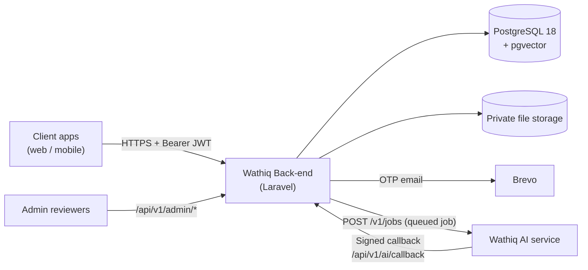

# Wathiq — Back-end

REST API for **Wathiq**, a property marketplace for sale and rent listings that takes a deal from listing to a lawyer-reviewed, AI-assisted contract. The API is built with Laravel and PostgreSQL and is currently scoped to a single jurisdiction (Palestine, code `PS`).

## Table of Contents

- [Overview](#overview)
- [Key Features](#key-features)
- [Technologies Used](#technologies-used)
- [Project Architecture](#project-architecture)
- [Project Structure](#project-structure)
- [Installation and Setup](#installation-and-setup)
- [Environment Variables](#environment-variables)
- [API Documentation](#api-documentation)
- [Usage](#usage)
- [Testing and Code Style](#testing-and-code-style)
- [Future Improvements](#future-improvements)
- [License](#license)

## Overview

Wathiq lets property owners list properties for sale or rent, lets other users request them, and moves an accepted request into a contract that a verified lawyer reviews before the owner and the beneficiary approve it.

The platform addresses a trust problem in property deals. Every participant is identity-checked, listings are backed by ownership documents that an administrator reviews, and contract drafting and analysis are handled by a separate AI service with a licensed lawyer approving the result.

**How it works**

1. A user signs up with an email one-time code (OTP) as a regular user or as a lawyer.
2. The user completes a profile and submits an identity document (KYC), which an admin reviews.
3. A verified owner creates a listing and uploads ownership documents. Once an admin approves them, the owner can publish the listing.
4. Other users browse published listings publicly and send a rent or purchase request.
5. The owner accepts a request and assigns a verified lawyer. The lawyer accepts it, which creates a contract and queues the AI service to draft it.
6. The lawyer reviews the draft and the AI's analysis findings, publishes new versions if needed, and approves it. The owner and the beneficiary then approve or reject it.

This repository is the Back-end only. The AI service is a separate project (`Wathiq-ps/Ai`) that this API talks to over HTTP.

## Key Features

### Authentication and accounts
- Passwordless sign-in and sign-up with an emailed OTP, with attempt limits, resend cooldown and lockout (configurable).
- Short-lived JWT access tokens and database-tracked, revocable, rotating refresh tokens.
- Role-based access: `user`, `lawyer` and `admin`.
- User profile management, including a profile image upload.

### Identity verification (KYC)
- Users submit an identity document and a selfie; the files are stored privately.
- Admins review submissions through a dedicated queue, with approve and reject (with reason) actions.
- Transacting endpoints require an approved identity (`kyc.verified` middleware).

### Lawyer onboarding
- Lawyers register through the same OTP flow and then submit a licence for admin review.
- A lawyer account stays inactive for transacting endpoints until an admin approves the licence (`lawyer.approved` middleware).

### Property listings
- Owners create, update, publish, suspend and delete listings and upload property media.
- Ownership documents go through an admin review queue; the decision updates the listing's status.
- Public endpoints for search (filter by `listing_type`, `city`, `district`; 20 results per page) and a home feed with top-rated and featured listings.
- Property ratings.

### Property requests
- Users send rent or purchase requests and track their history.
- Owners see incoming requests, list the approved lawyers, and accept (assigning a lawyer) or reject.
- Requests can be cancelled by the owner or requester until all three contract approvals are in. Rental requests with overlapping terms are cancelled automatically when a property becomes `rented`. The rules are in [docs/property-request-lifecycle.md](docs/property-request-lifecycle.md).

### Contracts and AI assistance
- Accepting a request as the assigned lawyer creates a contract and queues an AI draft.
- AI work is asynchronous: jobs are queued in the database, signed with an HMAC, and results return through a signed callback. Clients poll the contract and read `ai_job.status`.
- Lawyers can submit a contract for analysis, resolve findings, add contract versions, approve it or request modification.
- The owner and beneficiary approve the contract, or reject it with a note that returns it to the lawyer.

### Operations tooling
- Artisan commands for issuing tokens, granting admin, verifying a user's KYC and verifying knowledge sources (see [Usage](#usage)).

## Technologies Used

| Category | Technology |
| --- | --- |
| **Backend** | PHP 8.4+, Laravel 13 |
| **Database** | PostgreSQL 18 with the `pgvector` extension. The schema uses multiple Postgres schemas, enums, triggers and views, so SQLite cannot run it |
| **Authentication & Authorization** | Email OTP, JWT (`firebase/php-jwt`, HS256), custom middleware for JWT, admin, KYC and lawyer approval. `laravel/sanctum` is installed and its personal access tokens migration exists |
| **Queue, Cache, Sessions** | Laravel database drivers (`QUEUE_CONNECTION`, `CACHE_STORE` and `SESSION_DRIVER` default to `database`) |
| **Mail** | Brevo (`getbrevo/brevo-php`, `symfony/brevo-mailer`) for OTP emails |
| **File storage** | Laravel filesystem: private `local` disk for KYC, ownership and licence documents; `public` disk for profile images. An S3 disk is configured but unused by the services |
| **External service** | Wathiq AI service (`Wathiq-ps/Ai`) for contract generation and analysis |
| **Frontend tooling** | Vite 8 and Tailwind CSS 4 are included from the Laravel skeleton. There is no UI in this repository beyond the default welcome page |
| **Development tools** | Pest 5, Laravel Pint, Laravel Pail, Laravel Tinker, Laravel Boost, Faker, Mockery, Collision |
| **CI and infrastructure** | GitHub Actions (tests on Postgres 18 + pgvector, Pint check), a custom Postgres image (`docker/postgres/Dockerfile`), a pre-commit hook that runs Pint. Code comments refer to Railway as the hosting target |

## Project Architecture

The API follows a conventional layered Laravel structure: thin controllers validate input and delegate to services, which hold the business rules and talk to the database. Responses are shaped by API resources, and expected failures are domain exceptions that render as JSON with a stable error code.



**Main components**

| Component | Responsibility |
| --- | --- |
| Controllers (`app/Http/Controllers`) | Receive requests, authorize and return JSON. Grouped by area: `Auth`, `Profile`, `Kyc`, `Lawyer`, `Property`, `Contract`, `Admin`, `Ai` |
| Form requests (`app/Http/Requests`) | Input validation |
| Services (`app/Services`) | Business logic (OTP, JWT, KYC, properties, requests, contracts, lawyer review, AI jobs) |
| Middleware (`app/Http/Middleware`) | `auth.jwt`, `admin`, `kyc.verified`, `lawyer.approved` (aliases registered in `bootstrap/app.php`) |
| Models and resources | Eloquent models and API resources that shape responses |
| Jobs (`app/Jobs`) | `SendAiJob` posts a job to the AI service; `CheckAiJobTimeout` handles jobs whose callback never arrives |
| Database (`database/migrations`) | Raw-SQL migrations defining the `app`, `knowledge`, `ops` and `audit` schemas, enums, triggers and views |

**Contract and AI flow.** When a lawyer accepts a request, the contract and an `ai_jobs` row are written in one transaction together with the queued `SendAiJob`, so a contract is never left "generating" without a job to send. The AI service answers on `/api/v1/ai/callback`; the request is authenticated by its HMAC signature, applied idempotently, and validated against the AI's wire contract. The contract is pinned in `tests/Contract/ai` and synced with `scripts/sync-ai-contract.sh`.

## Project Structure

```text
.
├── app/
│   ├── Ai/                    # Wire-contract validation and request signing for the AI service
│   ├── Console/Commands/      # Artisan commands (user:token, user:make-admin, ...)
│   ├── Exceptions/            # Domain exceptions (Auth, Kyc, Lawyer, Property)
│   ├── Http/
│   │   ├── Controllers/       # Admin, Ai, Auth, Contract, Kyc, Lawyer, Profile, Property
│   │   ├── Middleware/        # JWT, admin, KYC and lawyer-approval guards
│   │   ├── Requests/          # Form request validation
│   │   └── Resources/         # JSON response shaping
│   ├── Jobs/                  # SendAiJob, CheckAiJobTimeout
│   ├── Mail/                  # OTP email
│   ├── Models/                # Eloquent models
│   ├── Services/              # Business logic
│   └── Support/               # Jurisdiction helper
├── bootstrap/app.php          # Routing, middleware aliases, JSON error handling
├── config/                    # Laravel config plus jwt.php and otp.php
├── database/
│   ├── migrations/            # Postgres schema (raw SQL) and later changes
│   ├── factories/
│   └── seeders/               # Roles, tenant, lawyer and reference data
├── docker/postgres/           # Postgres 18 + pgvector image
├── docs/                      # property-request-lifecycle.md
├── routes/api.php             # All API routes (served under /api)
├── scripts/                   # sync-ai-contract.sh
├── tests/                     # Pest tests and the pinned AI contract
├── .github/workflows/ci.yml   # CI: tests and Pint
└── .githooks/pre-commit       # Runs Pint on staged PHP files
```

## Installation and Setup

### Prerequisites

- PHP 8.4 or newer with the `pdo_pgsql` extension
- [Composer](https://getcomposer.org/)
- PostgreSQL 18 with the `pgvector` extension (the provided `docker/postgres/Dockerfile` builds a suitable image)
- Node.js and npm, only if you want to build the Vite assets

### Steps

1. **Clone the repository**

   ```bash
   git clone git@github.com:Wathiq-ps/Back-end.git
   cd Back-end
   ```

2. **Install PHP dependencies.** This also points Git hooks at `.githooks`.

   ```bash
   composer install
   ```

3. **Create the environment file and application key**

   ```bash
   cp .env.example .env
   php artisan key:generate
   ```

4. **Start PostgreSQL with pgvector and create a database.** For example, using the bundled Dockerfile:

   ```bash
   docker build -t wathiq-postgres docker/postgres
   docker run -d --name wathiq-db -e POSTGRES_PASSWORD=postgres -e POSTGRES_DB=wathiq -p 5432:5432 wathiq-postgres
   ```

5. **Configure `.env`.** `.env.example` defaults to SQLite, which the schema does not support. Switch to PostgreSQL and set the secrets (see [Environment Variables](#environment-variables)):

   ```dotenv
   DB_CONNECTION=pgsql
   DB_HOST=127.0.0.1
   DB_PORT=5432
   DB_DATABASE=wathiq
   DB_USERNAME=postgres
   DB_PASSWORD=postgres

   JWT_SECRET=<a-long-random-string>
   AI_WEBHOOK_SECRET=<shared-secret-with-the-ai-service>
   ```

6. **Run migrations and seed required data.** The migrations create the schema, the roles and the Palestine jurisdiction. The API requires a tenant with slug `default`, which the seeder creates:

   ```bash
   php artisan migrate
   php artisan db:seed --class=TenantSeeder
   ```

   Optionally, `php artisan db:seed` runs `RoleSeeder` and `LawyerSeeder`, which creates a test lawyer account for manual testing. Run `TenantSeeder` first, because `LawyerSeeder` needs the tenant.

7. **Start the application.** OTP emails and AI jobs are dispatched through the database queue, so a queue worker must run alongside the server.

   ```bash
   php artisan serve
   php artisan queue:work
   ```

   Or run the server, queue listener, log viewer and Vite together:

   ```bash
   npm install --ignore-scripts
   composer run dev
   ```

   The API is then available at `http://localhost:8000/api`, and the health check at `http://localhost:8000/up`.

> The `composer run setup` script exists, but it runs `migrate` against whatever database `.env` points to. Configure PostgreSQL in `.env` first, or it will fail on SQLite.

## Environment Variables

Values come from `.env.example`; real credentials must never be committed (`.env` is git-ignored).

| Variable | Purpose |
| --- | --- |
| `APP_KEY` | Laravel encryption key, generated with `php artisan key:generate` |
| `APP_URL` | Base URL; also used as the JWT issuer and to build public file URLs |
| `APP_JURISDICTION` | Jurisdiction code the API serves (default `PS`) |
| `DB_CONNECTION`, `DB_HOST`, `DB_PORT`, `DB_DATABASE`, `DB_USERNAME`, `DB_PASSWORD` | Database connection. Use `pgsql` |
| `DB_SSLMODE`, `DB_SEARCH_PATH` | Optional PostgreSQL settings (defaults `prefer` and `public,app,extensions`) |
| `JWT_SECRET` | HS256 signing secret for access tokens, independent of `APP_KEY` |
| `JWT_ACCESS_TTL` | Access token lifetime in seconds (default `900`) |
| `JWT_REFRESH_TTL` | Refresh token lifetime in seconds (default `2592000`) |
| `OTP_CODE_LENGTH`, `OTP_TTL_MINUTES`, `OTP_MAX_ATTEMPTS`, `OTP_RESEND_COOLDOWN_SECONDS`, `OTP_LOCKOUT_MINUTES` | OTP behaviour (defaults `6`, `5`, `5`, `60`, `15`) |
| `MAIL_MAILER`, `BREVO_API_KEY` | Mail transport. `.env.example` uses `brevo` and needs a Brevo **API v3** key (`xkeysib-...`), not an SMTP key |
| `MAIL_FROM_ADDRESS`, `MAIL_FROM_NAME` | Sender of OTP emails |
| `QUEUE_CONNECTION`, `CACHE_STORE`, `SESSION_DRIVER` | Default to `database` |
| `FILESYSTEM_DISK` | Default filesystem disk (`local`) |
| `AI_SERVICE_URL` | Base URL of the AI service (`http://localhost:8001` in the example) |
| `AI_WEBHOOK_SECRET` | Signs jobs sent to the AI service and verifies its callbacks. Must equal the AI service's `AI_WEBHOOK_SECRET` |

Example `.env` fragment (placeholders only):

```dotenv
APP_ENV=local
APP_URL=http://localhost:8000
DB_CONNECTION=pgsql
DB_HOST=127.0.0.1
DB_PORT=5432
DB_DATABASE=wathiq
DB_USERNAME=postgres
DB_PASSWORD=change-me
JWT_SECRET=change-me-to-a-long-random-string
MAIL_MAILER=brevo
BREVO_API_KEY=your-brevo-api-v3-key
AI_SERVICE_URL=http://localhost:8001
AI_WEBHOOK_SECRET=change-me-shared-secret
```

## API Documentation

All routes are defined in [routes/api.php](routes/api.php) and served under the `/api` prefix. Requests and responses are JSON, except file uploads, which are `multipart/form-data`. Errors on `/api/*` are always rendered as JSON.

### Authentication and access levels

Send the access token as `Authorization: Bearer <access_token>`.

| Level | Meaning |
| --- | --- |
| Public | No token |
| `auth` | A valid JWT (`auth.jwt`) |
| `kyc` | `auth` plus an approved identity document (`kyc.verified`) |
| `kyc+lawyer` | As `kyc`, plus `lawyer.approved`: it has no effect on ordinary users, and blocks lawyer accounts whose licence has not been approved |
| `admin` | `auth` plus the admin role |
| Signature | The AI callback, authenticated by HMAC signature instead of a JWT |

### Auth — `/api/v1/auth`

| Method | Endpoint | Access | Description |
| --- | --- | --- | --- |
| POST | `/otp/request` | Public (10/min) | Send an OTP. `status` is `login` or `register`; `role` (`user` or `lawyer`) is required when registering |
| POST | `/otp/verify` | Public (20/min) | Verify the code and receive tokens |
| POST | `/refresh` | Public (20/min) | Rotate the refresh token and receive a new token pair |
| POST | `/logout` | `auth` | Revoke a refresh token |
| GET | `/me` | `auth` | Current user |

Example: request a code.

```http
POST /api/v1/auth/otp/request
Content-Type: application/json

{ "email": "user@example.com", "status": "register", "role": "user" }
```

```json
{
  "message": "A verification code has been sent to your email.",
  "expires_in_minutes": 5
}
```

Example: verify the code.

```http
POST /api/v1/auth/otp/verify
Content-Type: application/json

{ "email": "user@example.com", "code": "123456" }
```

```json
{
  "user": { "id": "…", "email": "user@example.com", "role": "user", "identity_status": "not_submitted" },
  "access_token": "<jwt>",
  "refresh_token": "<token>",
  "token_type": "Bearer",
  "expires_in": 900
}
```

The `user` object also carries profile and identity fields (see `UserResource`); it is abbreviated here.

### Profile and KYC

| Method | Endpoint | Access | Description |
| --- | --- | --- | --- |
| GET | `/api/v1/profile` | `auth` | Get the profile |
| PATCH | `/api/v1/profile` | `auth` | Update profile fields |
| POST | `/api/v1/profile/image` | `auth` | Upload a profile image (POST because PHP only parses multipart uploads on POST) |
| POST | `/api/v1/kyc/documents` | `auth` | Submit an identity document and selfie. The profile must be complete first |
| GET | `/api/v1/kyc/status` | `auth` | Identity verification status (marked as a test endpoint in the route file) |

### Lawyer credentials

| Method | Endpoint | Access | Description |
| --- | --- | --- | --- |
| POST | `/api/v1/lawyer/credentials` | `auth` + `kyc.verified` | Submit a licence for review |
| GET | `/api/v1/lawyer/credentials/status` | `auth` | Licence review status |

### Properties

| Method | Endpoint | Access | Description |
| --- | --- | --- | --- |
| GET | `/api/v1/properties/search` | Public | Published listings. Query: `listing_type` (`sale` or `rent`), `city`, `district`, `page` |
| GET | `/api/v1/properties/home` | Public | Home feed with top-rated and featured properties |
| GET | `/api/v1/properties/{id}` | Public | Property details |
| GET | `/api/v1/properties/my-properties` | `kyc+lawyer` | The caller's listings (optional `status` filter) |
| GET | `/api/v1/properties/my-properties/{id}` | `kyc+lawyer` | One of the caller's listings |
| POST | `/api/v1/properties` | `kyc+lawyer` | Create a listing (starts under review) |
| PATCH | `/api/v1/properties/{id}` | `kyc+lawyer` | Update a listing |
| PATCH | `/api/v1/properties/{id}/publish` | `kyc+lawyer` | Publish |
| PATCH | `/api/v1/properties/{id}/suspend` | `kyc+lawyer` | Suspend |
| DELETE | `/api/v1/properties/{id}` | `kyc+lawyer` | Delete |
| POST | `/api/v1/properties/{id}/ratings` | `kyc+lawyer` | Rate a property |

### Property requests

All routes below require `kyc+lawyer`.

| Method | Endpoint | Description |
| --- | --- | --- |
| POST | `/api/v1/properties/{id}/requests` | Send a rent or purchase request |
| GET | `/api/v1/properties/my-requests` | Requests the caller has sent |
| GET | `/api/v1/properties/incoming-requests` | Requests received for the caller's properties |
| GET | `/api/v1/properties/requests/{propertyRequest}/lawyers` | Verified lawyers the owner can assign |
| PATCH | `/api/v1/properties/requests/{propertyRequest}/accept` | Owner accepts and assigns a lawyer |
| PATCH | `/api/v1/properties/requests/{propertyRequest}/reject` | Owner rejects |
| PATCH | `/api/v1/properties/requests/{propertyRequest}/cancel` | Owner or requester cancels (see [lifecycle doc](docs/property-request-lifecycle.md)) |
| GET | `/api/v1/lawyer/requests` | Requests assigned to the lawyer |
| PATCH | `/api/v1/lawyer/requests/{propertyRequest}/accept` | Lawyer accepts; creates the contract and queues the AI draft |
| PATCH | `/api/v1/lawyer/requests/{propertyRequest}/reject` | Lawyer rejects |

### Contracts

All routes below require `kyc+lawyer` and apply to contracts the caller is a party to.

| Method | Endpoint | Description |
| --- | --- | --- |
| GET | `/api/v1/contracts` | List contracts |
| GET | `/api/v1/contracts/{contract}` | Contract with its AI job status |
| POST | `/api/v1/contracts/{contract}/analysis` | Submit for AI analysis |
| POST | `/api/v1/contracts/{contract}/generation` | Retry AI generation |
| PATCH | `/api/v1/contracts/{contract}/findings/{finding}` | Lawyer resolves an analysis finding |
| POST | `/api/v1/contracts/{contract}/versions` | Lawyer adds a contract version |
| POST | `/api/v1/contracts/{contract}/approval` | Lawyer approves |
| POST | `/api/v1/contracts/{contract}/modification-request` | Lawyer requests modification |
| POST | `/api/v1/contracts/{contract}/party-approval` | Owner or beneficiary approves |
| POST | `/api/v1/contracts/{contract}/party-rejection` | Owner or beneficiary rejects with a note |

### AI callback

| Method | Endpoint | Access | Description |
| --- | --- | --- | --- |
| POST | `/api/v1/ai/callback` | Signature | Receives job results from the AI service. Verified with the `X-Wathiq-Signature` HMAC header; not rate limited |

### Admin — requires `admin`

| Method | Endpoint | Description |
| --- | --- | --- |
| GET | `/api/v1/admin/kyc/documents` | Identity review queue |
| GET | `/api/v1/admin/kyc/documents/{identityDocument}` | Submission details |
| GET | `/api/v1/admin/kyc/documents/{identityDocument}/image/{which}` | View a stored image |
| POST | `/api/v1/admin/kyc/documents/{identityDocument}/approve` | Approve |
| POST | `/api/v1/admin/kyc/documents/{identityDocument}/reject` | Reject with a reason |
| GET | `/api/v1/admin/lawyers` | Lawyer licence queue |
| GET | `/api/v1/admin/lawyers/{lawyerCredential}` | Licence details |
| GET | `/api/v1/admin/lawyers/{lawyerCredential}/document` | Licence file |
| POST | `/api/v1/admin/lawyers/{lawyerCredential}/approve` | Approve |
| POST | `/api/v1/admin/lawyers/{lawyerCredential}/reject` | Reject |
| GET | `/api/v1/admin/properties/documents` | Ownership document queue |
| GET | `/api/v1/admin/properties/documents/{ownershipDocument}/file` | Ownership document file |
| POST | `/api/v1/admin/properties/documents/{ownershipDocument}/approve` | Approve; releases the listing for publishing |
| POST | `/api/v1/admin/properties/documents/{ownershipDocument}/reject` | Reject with a reason |
| GET | `/api/v1/admin/properties` | All properties |
| GET | `/api/v1/admin/properties/{property}` | Property details |
| GET | `/api/v1/admin/properties/{property}/documents` | Ownership documents of a property |

For request bodies and validation rules, see the form requests in `app/Http/Requests` and the resources in `app/Http/Resources`.

## Usage

A typical end-to-end flow, from the client's point of view:

1. **Sign up and sign in.** Call `/auth/otp/request` with `status: "register"`, then `/auth/otp/verify`. Use `/auth/refresh` before the access token expires.
2. **Complete the profile and submit KYC.** Update the profile, then submit the identity document at `/kyc/documents`. Poll `/auth/me` for `identity_status`, which moves through `not_submitted`, `pending`, `under_review`, `approved` or `rejected`.
3. **List a property.** Create it, upload ownership documents, and wait for an admin to approve them. Then publish it.
4. **Browse and request.** Use the public search and home endpoints, then send a request for a published property.
5. **Decide and assign a lawyer.** The owner lists lawyers for the request and accepts it with one of them; the lawyer accepts in turn, which creates the contract.
6. **Review the contract.** The lawyer reviews the AI draft and analysis, then approves it. The owner and beneficiary approve or reject it. Throughout, poll `GET /contracts/{contract}` for the AI job status.

### Command-line tools

| Command | Purpose |
| --- | --- |
| `php artisan user:make-admin {email}` | Grant the admin role to an existing user |
| `php artisan user:token {email} [--create]` | Issue an access and refresh token pair, bypassing OTP (development) |
| `php artisan user:verify-kyc {email} [--reviewer=] [--type=]` | Mark a user KYC-verified by approving their identity document |
| `php artisan knowledge:verify-sources [--jurisdiction=PS] [--admin=] [--force]` | Mark a jurisdiction's knowledge sources as verified |

## Testing and Code Style

The test suite uses Pest. Most tests exercise the raw Postgres schema, so run them against PostgreSQL as CI does. `phpunit.xml` defaults to in-memory SQLite, which cannot load that schema, so set the `DB_*` variables in your shell:

```bash
DB_CONNECTION=pgsql DB_HOST=127.0.0.1 DB_PORT=5432 DB_DATABASE=wathiq_test DB_USERNAME=postgres DB_PASSWORD=postgres php artisan test
```

Check formatting with Laravel Pint (CI runs the same check, and the pre-commit hook formats staged PHP files automatically):

```bash
vendor/bin/pint --test
```

The AI service's wire contract is pinned in `tests/Contract/ai`. To check it against the AI repository's `main` branch, run `scripts/sync-ai-contract.sh --check`.

## Future Improvements

The repository has no roadmap document. The following are limited to what the code states is not yet built:

- **Payments, wallets, receipts, signatures, contract execution and notifications.** The database schema already defines tables for these (signature invitations and seals, payments, wallets, handover codes, contract executions, notifications), but no API endpoints or services use them yet.
- **WhatsApp OTP delivery.** The OTP schema and code mark the WhatsApp channel as reserved for later.
- **Additional jurisdictions.** The API is pinned to one jurisdiction (`PS`) for the MVP.

## License

`composer.json` declares the project as **MIT**-licensed. The repository does not include a `LICENSE` file.
